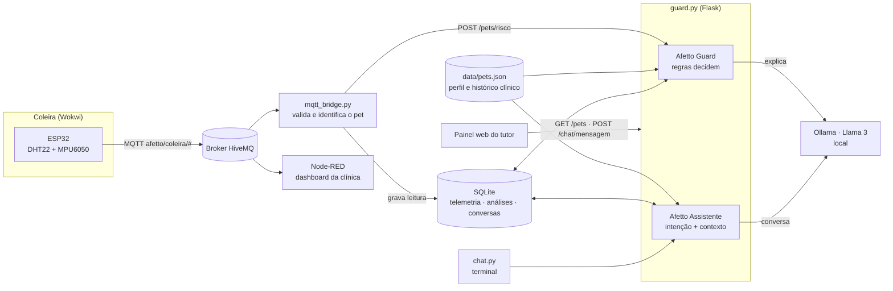

# Afetto — IA Preventiva e Assistente

> A coleira capta sinais da rotina do pet, e a IA transforma esses sinais em cuidado preventivo para o tutor.

Projeto acadêmico da disciplina **Disruptive Architectures: IoT, IoB & Generative IA**, construído para a jornada de cuidado contínuo da **CLYVO VET** (Challenge FIAP 2026).

## Entrega — 4º Sprint

| Item | Acesso |
| --- | --- |
| Vídeo pitch e demonstração funcional | Link em [`../LinkYouTube.txt`](../LinkYouTube.txt) (YouTube, não listado) |
| Repositório | https://github.com/Afetto/Iot-Afetto |
| Evidências de funcionamento | [`../evidencias/`](../evidencias/README.md): telas, conversas, análise e testes |
| Diagrama de arquitetura | Seção [Arquitetura](#arquitetura) e [PDF](docs/arquitetura-afetto-ia.pdf) |

### O que mudou do 3º para o 4º Sprint

| Requisito do Sprint 4 | Como foi atendido |
| --- | --- |
| Implementar a solução de IA definida | **Afetto Guard** (motor de regras + Llama 3) e **Afetto Assistente** (agente conversacional com contexto) implementados e integrados |
| Preparar e organizar os dados, com testes e validação | Base estruturada [`data/pets.json`](data/pets.json) com perfil, vacinas, consultas, doenças e medicamentos. O módulo [`dados.py`](dados.py) valida cada registro e calcula os indicadores. Os testes cobrem a validação |
| Integração entre aplicação, banco, APIs e IA | API REST em Flask + banco **SQLite** ([`db.py`](db.py)) com telemetria, análises e conversas + ponte MQTT da coleira |
| Funcionalidade acessível ao usuário final | **Painel web do tutor** em `http://localhost:5000`, com coleira ao vivo, análise preventiva e chat |
| Evidências do funcionamento | Pasta [`evidencias/`](../evidencias/README.md) e 38 testes automatizados |

## O problema

Na rotina do tutor, mudanças de temperatura, atividade e comportamento passam despercebidas ou geram dúvida: é algo pontual ou é hora de procurar a clínica? Quando o histórico está espalhado, a decisão fica mais difícil e o cuidado tende a ser reativo.

Na pesquisa exploratória do projeto, com 102 tutores:

- 68% têm dificuldade para entender se uma mudança de comportamento pode indicar problema de saúde.
- 76% têm dúvida sobre quando procurar atendimento veterinário.
- 61% não têm histórico centralizado de saúde e rotina do pet.

## A solução de IA

Abordagem **híbrida**: as regras **decidem**, o LLM local **explica** e o agente **conversa**.

| Componente | Técnica | Responsabilidade |
| --- | --- | --- |
| **Motor de regras** ([`regras.py`](regras.py)) | Sistema de classificação determinístico | Calcula score (0–100), nível de risco, riscos e recomendações por urgência. É auditável e testável |
| **Afetto Guard** ([`guard.py`](guard.py)) | Regras + IA generativa (Llama 3 via Ollama) | Junta a telemetria com o histórico clínico, decide pelas regras e usa o Llama para escrever uma mensagem empática e personalizada. O LLM **nunca altera** a decisão |
| **Afetto Assistente** ([`assistente.py`](assistente.py)) | Agente conversacional com RAG simplificado | Identifica a intenção da pergunta, injeta no prompt os dados reais do pet (perfil, vacinas, consultas, coleira, última análise) e responde em linguagem natural |
| **Guarda de segurança** | Regras de proteção | Mensagens com sinais de emergência (convulsão, sangramento, envenenamento…) recebem resposta fixa e imediata, sem passar pelo LLM |
| **Fallback** | Respostas por regras | Se o Ollama estiver fora do ar, Guard e Assistente respondem com regras sobre os mesmos dados. O tutor nunca fica sem retorno |

**Por que Llama 3 local (Ollama)?** Não tem custo por requisição, os dados clínicos não saem da máquina e o modelo pode ser trocado por variável de ambiente (`OLLAMA_MODEL`).

### Regras de risco

| Sinal | Regra | Peso |
| --- | --- | --- |
| Temperatura 37,5–39,2 °C | Normal | 0 |
| Temperatura até 4 °C fora da faixa (33,5–37,4 ou 39,3–43,2 °C) | Atenção | +20 |
| Temperatura além da margem (< 33,5 ou > 43,2 °C) | Crítico | +70 |
| Atividade < 0,3 / < 0,8 | Inatividade severa / baixa | +70 / +10 |
| Vacinas vencidas | Preventivo | +15 |
| Sem consulta há > 12 / > 6 meses | Preventivo | +15 / +10 |
| Cão com 7 anos ou mais | Pet sênior | +10 |

Níveis: **baixo** < 20 · **médio** 20–39 · **alto** 40–69 · **crítico** ≥ 70. As faixas de temperatura são as mesmas do firmware da coleira.

## Dados utilizados

| Dado | Origem | Uso |
| --- | --- | --- |
| Temperatura e atividade | Coleira ESP32 (DHT22 + MPU6050) via MQTT | Detectar febre, hipotermia e inatividade |
| Status e alertas da coleira | Firmware ESP32 | Classificação imediata no dispositivo (LED) |
| Perfil (espécie, raça, nascimento, peso, sexo) | `data/pets.json` | Personalizar a análise (ex.: pet sênior) e a linguagem |
| Vacinas (aplicação e próxima dose) | `data/pets.json` | Identificar vacinas vencidas e a próxima vacina |
| Consultas, doenças crônicas e medicamentos | `data/pets.json` | Contexto clínico do Guard e do Assistente |
| Histórico de telemetria, análises e conversas | SQLite (`runtime/afetto.db`) | Gráfico no painel, memória da conversa, rastreabilidade |

**Preparação e validação.** Ao carregar a base, [`dados.py`](dados.py) rejeita registros com campos obrigatórios ausentes, espécie inválida, peso fora da faixa, datas mal formatadas ou no futuro, próxima dose anterior à aplicação e ids duplicados. Depois calcula os indicadores que a IA consome: idade, vacinas em dia ou vencidas, próxima vacina e meses desde a última consulta. Dados ausentes ficam como **desconhecidos** e nunca são simulados. Os dados de `pets.json` são fictícios, criados para a demonstração.

## Arquitetura



### API

| Método | Rota | Descrição |
| --- | --- | --- |
| GET | `/` | Painel web do tutor |
| GET | `/health` | Status do serviço, do Ollama, da base e do banco |
| GET | `/pets` | Pets com última leitura e último nível de risco |
| GET | `/pets/<id>` | Perfil, indicadores, últimas 20 leituras e últimas 5 análises |
| POST | `/pets/<id>/analisar` | Roda o Guard com a última leitura da coleira |
| POST | `/pets/risco` | Análise a partir de uma telemetria (usada pela ponte MQTT) |
| POST | `/chat/mensagem` | Conversa com o Assistente: `{"pet_id": "mel", "mensagem": "...", "sessao_id": "opcional"}` |

## Tecnologias

Python 3.10+ · Flask · SQLite · paho-mqtt · Ollama + Llama 3 · ESP32, DHT22 e MPU6050 no Wokwi · HiveMQ · Node-RED · HTML/JS (painel) · `unittest`

## Estrutura

```text
IA-prev-ass/
├── guard.py            # API Flask: Guard, Assistente, painel e health check
├── regras.py           # Motor de regras (faixas de temperatura, score, níveis)
├── assistente.py       # Agente conversacional (segurança, intenção, prompt, fallback)
├── dados.py            # Carga, validação e indicadores da base de pets
├── db.py               # Persistência SQLite
├── llm.py              # Cliente do Ollama (modelo configurável)
├── mqtt_bridge.py      # Ponte MQTT → banco + Guard
├── chat.py             # Assistente no terminal
├── simular_coleira.py  # Simulador de coleira (sem Wokwi)
├── data/pets.json      # Base de perfis e histórico clínico
├── web/painel.html     # Painel do tutor
├── tests/              # 38 testes automatizados
├── docs/               # Diagrama em PDF
└── runtime/            # Banco SQLite e arquivos gerados em execução
```

## Como executar

### 1. Pré-requisitos

- Python 3.10 ou superior
- [Ollama](https://ollama.com) instalado (opcional: sem ele, o sistema roda pelo motor de regras)

### 2. Instalar

```bash
cd IA-prev-ass
python -m venv .venv
# Windows:  .\.venv\Scripts\Activate.ps1
# Linux/macOS:  source .venv/bin/activate
pip install -r requirements.txt
ollama pull llama3
```

Para usar outro modelo, por exemplo `llama3.2:3b`, defina `OLLAMA_MODEL` antes de iniciar.

### 3. Rodar

Em terminais separados:

```bash
python guard.py          # API + painel em http://localhost:5000
python mqtt_bridge.py    # recebe a coleira e aciona o Guard
```

Em seguida, dê **▶ Play** no Wokwi. Se o Wokwi não estiver disponível, simule a coleira:

```bash
python simular_coleira.py --pet Bolinha --cenario febre
python simular_coleira.py --pet Mel --cenario inativo
```

Abra **http://localhost:5000**, escolha o pet e acompanhe a coleira, a análise e o chat. O chat também pode ser usado no terminal com `python chat.py`.

### 4. Testar

```bash
python -m unittest discover -s tests -v
```

## Resultados

- Fluxo completo funcionando: coleira → MQTT → ponte → banco → Guard → painel e chat.
- Análise de risco que combina sinais da coleira com o histórico clínico. Exemplo: a Mel está com temperatura normal, mas atividade baixa, vacinas vencidas e idade sênior somam risco crítico.
- Assistente que responde com os dados reais do pet, mantém o histórico da conversa e não inventa nem diagnostica.
- Decisão de risco determinística e auditável; o LLM só personaliza o texto (garantido por teste).
- Serviço resiliente: Ollama fora do ar ou payload inválido não derrubam o sistema.
- 38 testes automatizados aprovados.

## Limites e próximos passos

Este é um protótipo acadêmico, não um dispositivo médico. Os limiares de risco são demonstrativos e precisam de validação veterinária antes de qualquer uso real. Próximos passos: sincronizar a base local com a API Java da plataforma, levar o painel para o app mobile, autenticar o tutor e validar os alertas com profissionais da CLYVO VET.
