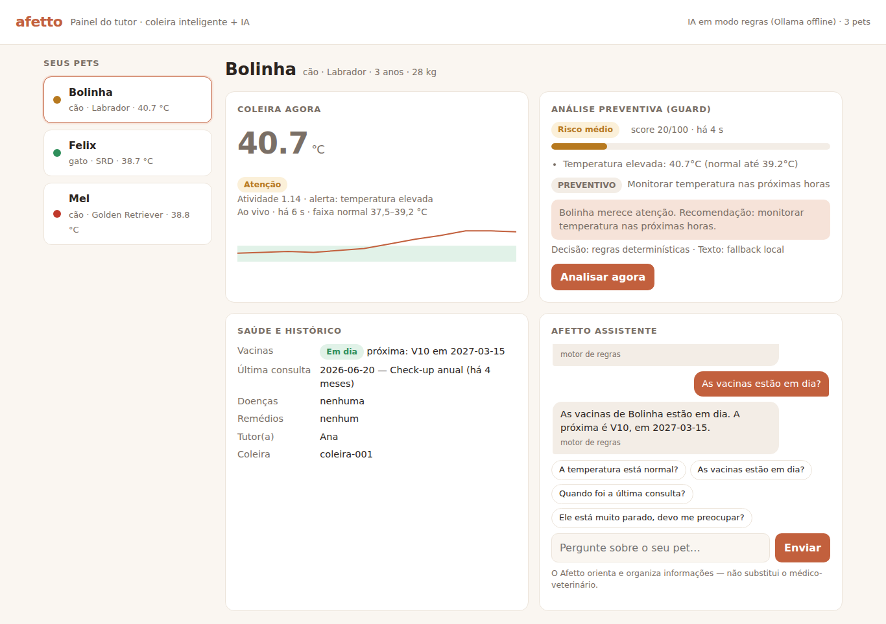
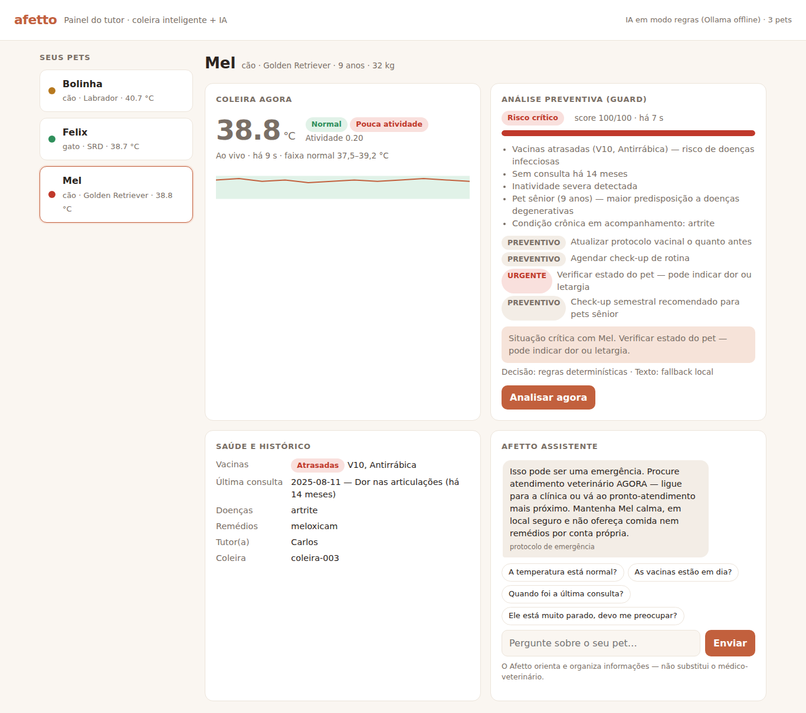

# 🐾 Afetto — IoT & IA
> Challenge FIAP 2026 — Sprints 1, 3 e 4 | Empresa parceira: CLYVO VET

**Entrega do 4º Sprint:** a IA foi integrada a dados estruturados, a um banco SQLite e a um **painel web do tutor** com chat e análise preventiva. Veja as [evidências de funcionamento](evidencias/README.md) e a [documentação técnica da IA](IA-prev-ass/README.md).

---

## 📋 Índice

- [Sobre o Projeto](#sobre-o-projeto)
- [Estrutura do Repositório](#estrutura-do-repositório)
- [Módulo IoT — Coleira Inteligente](#módulo-iot--coleira-inteligente)
- [Módulo IA — Afetto Guard e Assistente](#módulo-ia--afetto-guard-e-assistente)
- [Evidências](#evidências)
- [Dashboard Node-RED](#dashboard-node-red)
- [Como Executar](#como-executar)
- [Tópicos MQTT](#tópicos-mqtt)
- [Repositórios do Projeto](#repositórios-do-projeto)
- [Equipe](#equipe)

---

## 🧠 Sobre o Projeto

O **Afetto** é uma plataforma digital que acompanha a jornada contínua de saúde do pet, criando uma experiência proativa e personalizada para o tutor e para a clínica veterinária.

Este repositório contém dois módulos integrados:

| Módulo | Descrição |
|--------|-----------|
| **IoT** | Coleira inteligente com ESP32 simulada no Wokwi |
| **IA** | Microserviço Python com Llama 3 para análise preventiva e chat assistente |

---

## 📁 Estrutura do Repositório

```
Iot-Afetto/
│
├── Wokwi/                        # Módulo IoT
│   ├── Wifi-scan.ino             # Código principal do ESP32
│   ├── diagrem.json              # Circuito completo do Wokwi
│   └── libraries.txt             # Bibliotecas necessárias
│
├── IA-prev-ass/                  # Módulo de IA
│   ├── guard.py                  # API Flask: Guard, Assistente e painel web
│   ├── regras.py                 # Motor de regras (decisão de risco)
│   ├── assistente.py             # Agente conversacional com contexto
│   ├── dados.py                  # Validação e indicadores da base de pets
│   ├── db.py                     # Persistência SQLite
│   ├── llm.py                    # Cliente Ollama / Llama 3
│   ├── mqtt_bridge.py            # Ponte MQTT → banco + Guard
│   ├── chat.py                   # Assistente no terminal
│   ├── simular_coleira.py        # Simulador de coleira (sem Wokwi)
│   ├── data/pets.json            # Perfis e histórico clínico
│   ├── web/painel.html           # Painel do tutor
│   ├── docs/                     # Diagrama arquitetural (PDF)
│   ├── tests/                    # 38 testes automatizados
│   └── runtime/                  # Banco e dados gerados em execução
│
├── Node-red/
│   └── Fluxo.json                # Dashboard da clínica
│
├── evidencias/                   # Telas, conversas, análise e testes
├── LinkYouTube.txt               # Link do vídeo de demonstração
└── README.md
```

---

## 🔌 Módulo IoT — Coleira Inteligente

### O que faz

Simula uma **coleira inteligente** que monitora o pet em tempo real e envia dados via MQTT para o dashboard da clínica.

### Componentes

| Componente | Função |
|------------|--------|
| ESP32 DevKit C V4 | Microcontrolador principal |
| DHT22 | Temperatura e umidade corporal |
| MPU6050 | Acelerômetro — nível de atividade |
| LED RGB | Feedback visual do status (verde/amarelo/vermelho) |
| Botão vermelho | Simula febre alta (GPIO 18) |
| Botão azul | Simula inatividade (GPIO 19) |
| Resistores 220Ω | Proteção do LED RGB |

### Conexões

| Componente | Pino | ESP32 |
|------------|------|-------|
| DHT22 VCC | — | 3V3 |
| DHT22 DATA | — | GPIO 4 |
| DHT22 GND | — | GND |
| MPU6050 VCC | — | 3V3 |
| MPU6050 GND | — | GND |
| MPU6050 SDA | — | GPIO 21 |
| MPU6050 SCL | — | GPIO 22 |
| LED R | 220Ω | GPIO 25 |
| LED GND | — | GND |
| LED G | 220Ω | GPIO 26 |
| LED B | 220Ω | GPIO 27 |
| Botão Febre | — | GPIO 18 + GND |
| Botão Inativo | — | GPIO 19 + GND |

### Lógica de classificação

A classificação do firmware usa apenas a temperatura (if/else simples):

| Faixa de temperatura | Status | LED |
|----------------------|--------|-----|
| 37,5 °C a 39,2 °C | 🟢 Normal | Verde |
| 33,5 °C a 37,4 °C ou 39,3 °C a 43,2 °C (margem de 4 °C) | 🟡 Atenção | Amarelo |
| Abaixo de 33,5 °C ou acima de 43,2 °C | 🔴 Crítico | Vermelho |

O Afetto Guard aplica as mesmas faixas de temperatura e ainda considera a atividade do pet (atividade < 0,3 = inatividade severa).

### Simulação de situações

| Botão | Efeito | LED | Alerta |
|-------|--------|-----|--------|
| Nenhum | Temperatura lida do DHT22 | Conforme a faixa | — |
| Vermelho (Febre) | Temperatura → 40,8 °C | 🟡 Amarelo | `temperatura_elevada` |
| Azul (Inativo) | Atividade → 0,1 (vai para o Guard/Chat) | Não altera o LED | — |

> ⚠️ O DHT22 do Wokwi começa em 24 °C, que a regra classifica como hipotermia crítica. Clique no sensor durante a simulação e ajuste a temperatura para cerca de 38,5 °C. Para simular um estado crítico, use valores acima de 43,2 °C ou abaixo de 33,5 °C.

-------|--------|-----|--------|
| Nenhum | Estado normal | 🟢 Verde | — |
| Vermelho (Febre) | Temperatura → 40.8°C | 🔴 Vermelho | Febre alta |
| Azul (Inativo) | Atividade → 0.1 | 🔴 Vermelho | Inatividade |

---

## 🤖 Módulo IA — Afetto Guard e Assistente

Abordagem **híbrida**: um motor de regras **decide** o risco, o Llama 3 local (Ollama) **explica** em linguagem natural e um agente conversacional **responde** ao tutor com os dados reais do pet.

```
Coleira (MQTT) ──► mqtt_bridge.py ──► SQLite (telemetria)
                         │
                         ▼
 data/pets.json ──► Afetto Guard ──► motor de regras decide ──► Llama 3 explica
 (perfil, vacinas,       │                                         │
  consultas, remédios)   ▼                                         ▼
                   Painel web do tutor  ◄──  Afetto Assistente (chat com contexto)
```

| Componente | O que faz |
|------------|-----------|
| **Afetto Guard** | Junta a leitura da coleira com o histórico clínico e gera score de 0 a 100, nível, riscos e recomendações por urgência |
| **Afetto Assistente** | Chat que identifica a intenção da pergunta (temperatura, vacina, remédio, consulta, alimentação, atividade) e responde usando a coleira, a carteirinha e a última análise |
| **Protocolo de emergência** | Perguntas com sinais graves (convulsão, sangramento…) recebem orientação imediata, sem passar pelo LLM |
| **Fallback** | Sem Ollama, o Guard e o Assistente respondem pelo motor de regras e o sistema nunca fica sem resposta |
| **Painel web** | `http://localhost:5000`: coleira ao vivo com gráfico, análise preventiva, saúde e histórico, e chat |

| Score | Nível |
|-------|-------|
| 0–19 | 🟢 Baixo |
| 20–39 | 🟡 Médio |
| 40–69 | 🟠 Alto |
| 70–100 | 🔴 Crítico |

Detalhes técnicos (dados, regras, API, arquitetura): [IA-prev-ass/README.md](IA-prev-ass/README.md).

---

## 📸 Evidências

| Bolinha — atenção | Mel — crítico |
|---|---|
|  |  |

Conversas de exemplo, análise completa e resultado dos testes estão em [evidencias/README.md](evidencias/README.md).

---

## 📊 Dashboard Node-RED

O arquivo `Node-red/Fluxo.json` contém o fluxo completo para importar no Node-RED.

**O que exibe em tempo real:**

| Widget | Dado |
|--------|------|
| Gauge | Temperatura corporal (°C) |
| Gauge | Nível de atividade |
| Card | Status do pet (🟢/🟡/🔴) |
| Painel | Alertas de febre ou inatividade |

**Broker MQTT configurado:**
```
Servidor: broker.hivemq.com
Porta:    8083
```

---

## 🚀 Como Executar

### Pré-requisitos

- [Wokwi](https://wokwi.com) (conta gratuita)
- [Node-RED](https://nodered.org) instalado localmente
- Python 3.10+
- [Ollama](https://ollama.com) instalado com Llama 3

---

### 1. Coleira IoT (Wokwi)

1. Acessa [wokwi.com](https://wokwi.com) e cria um novo projeto ESP32
2. Copia o conteúdo de `Wokwi/diagrem.json` para o `diagram.json`
3. Copia o conteúdo de `Wokwi/Wifi-scan.ino` para o sketch
4. Cria um arquivo `libraries.txt` com o conteúdo de `Wokwi/libraries.txt`
5. Clica **▶ Play**

---

### 2. Dashboard Node-RED

```bash
# Abre o Node-RED
node-red

# Acessa http://localhost:1880
# Menu → Import → cola o conteúdo de Node-red/Fluxo.json
# Deploy
# Dashboard em http://localhost:1880/ui
```

---

### 3. IA — Afetto Guard, Assistente e painel

```bash
cd IA-prev-ass
pip install -r requirements.txt
ollama pull llama3            # opcional: sem Ollama, roda pelo motor de regras

python guard.py               # Terminal 1 → API + painel em http://localhost:5000
python mqtt_bridge.py         # Terminal 2 → recebe a coleira e aciona o Guard
```

Abra **http://localhost:5000** e escolha o pet. Sem o Wokwi, a coleira pode ser simulada:

```bash
python simular_coleira.py --pet Bolinha --cenario febre
```

Para usar o Assistente no terminal: `python chat.py`.

### 4. Testes

```bash
cd IA-prev-ass
python -m unittest discover -s tests -v    # 38 testes
```

---

### Ordem recomendada para demonstração

```
1. ollama serve               → checar com: ollama list
2. python guard.py            → Terminal 1 (API + painel)
3. python mqtt_bridge.py      → Terminal 2 (coleira → banco → Guard)
4. Wokwi ▶ Play               → ou: python simular_coleira.py
5. http://localhost:5000      → painel do tutor (coleira, análise, chat)
6. Node-RED /ui               → dashboard da clínica
```

---

## 📡 Tópicos MQTT

| Tópico | Descrição | Payload |
|--------|-----------|---------|
| `afetto/coleira/temperatura` | Temperatura e umidade | `{"valor": 38.5, "umidade": 65}` |
| `afetto/coleira/movimento` | Nível de atividade | `{"valor": 0.95}` |
| `afetto/coleira/status` | Status classificado | `{"status": "normal", "temp": 38.5, "accel": 0.95, "pet": "Bolinha"}` |
| `afetto/coleira/alerta` | Alertas (atenção e crítico) | `{"alerta": true, "nivel": "atencao", "motivo": "temperatura_elevada", "pet": "Bolinha"}` |

---

## 🔗 Repositórios do Projeto

| Repositório | Stack | Descrição |
|-------------|-------|-----------|
| [java-afetto](https://github.com/Afetto/java-afetto) | Java + Spring Boot | API REST principal |
| [front-end-afetto](https://github.com/Afetto/front-end-afetto) | React Native + Expo | App mobile |
| [Iot-Afetto](https://github.com/Afetto/Iot-Afetto) *(este)* | C++ + Python + ESP32 | Coleira IoT + IA |

---

## 👥 Equipe

| Nome | RM |
|------|----|
| Gustavo Souto de Melo | 558595 |
| Iago Liziero Pereira | 564063 |
| Ícaro José dos Santos | 562403 |
| Leonardo Barbosa Santos | 558230 |

---

<div align="center">
  <p>Feito com 🐾 para o Challenge FIAP 2026</p>
  <p><strong>Afetto — O sistema operacional do cuidado contínuo do pet</strong></p>
</div>
