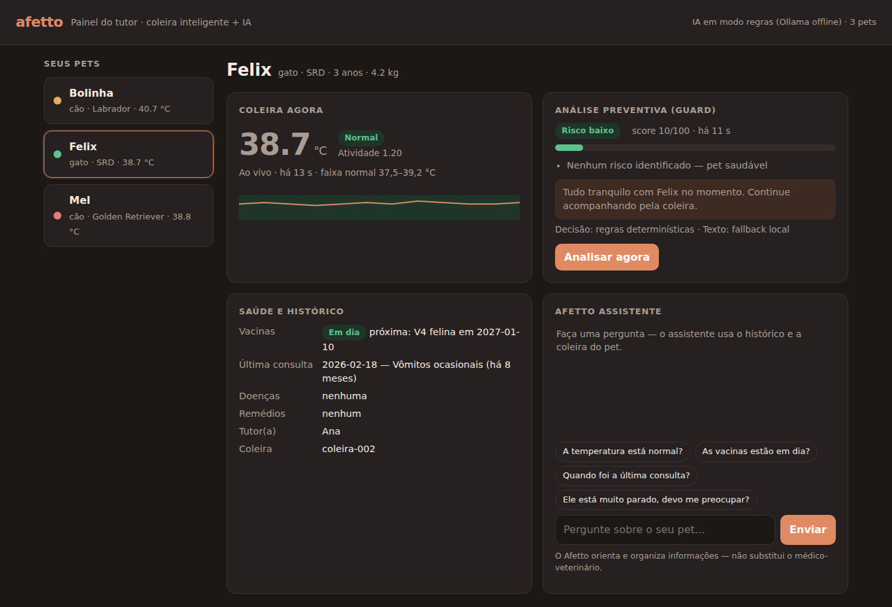
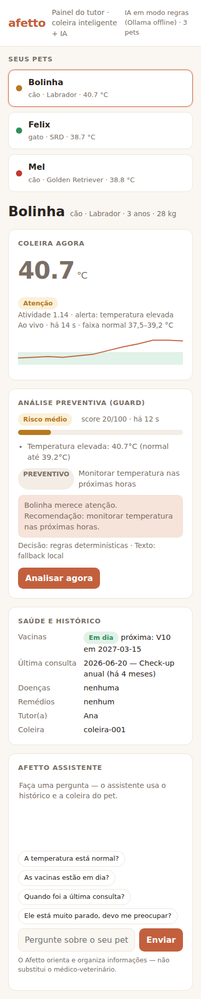

# 📸 Evidências de funcionamento — Sprint 4

Evidências geradas executando o projeto localmente (`guard.py` + base `data/pets.json` + banco SQLite), com leituras de coleira dos três pets de demonstração.

> As capturas foram feitas com o **Ollama desligado**, para mostrar que a solução continua funcionando pelo motor de regras (fallback). Com o Ollama ligado, a mensagem ao tutor e as respostas do chat passam a ser geradas pelo Llama 3, e o painel mostra a fonte "Llama 3 (local)". A decisão de risco continua a mesma, porque quem decide é sempre o motor de regras.

## 1. Painel do tutor

| Tela | O que mostra |
|------|--------------|
|  | **Bolinha — atenção.** A coleira marca 40,7 °C (fora da faixa normal de 37,5–39,2 °C), o gráfico mostra a subida, o Guard classifica como risco médio e o Assistente responde usando a leitura e a carteirinha de vacinas. |
|  | **Mel — crítico.** A temperatura está normal, mas a atividade está em 0,20. Somando vacinas vencidas, 14 meses sem consulta, idade sênior e artrite, o Guard dá score 100/100. No chat, a palavra "convulsão" aciona o protocolo de emergência sem passar pelo LLM. |
|  | **Felix — risco baixo**, em tema escuro. |
|  | Layout responsivo no celular. |

## 2. Conversas com o Afetto Assistente

Respostas reais da rota `POST /chat/mensagem`:

| Pet | Pergunta do tutor | Resposta | Intenção / fonte |
|-----|-------------------|----------|------------------|
| Bolinha | A temperatura está normal? | A temperatura de Bolinha está em 40.7°C, fora da faixa normal. Mantenha-o em repouso, ofereça água e acompanhe nas próximas horas; se persistir, procure o veterinário. | `temperatura` / `regras` |
| Bolinha | Ele não quer comer desde ontem | Mudanças no apetite de Bolinha merecem atenção. Ofereça água fresca e observe por 24 horas; se houver vômito repetido, diarreia, apatia ou recusa total de comida, procure o veterinário. | `alimentacao` / `regras` |
| Mel | As vacinas estão em dia? | Mel está com vacinas atrasadas: V10, Antirrábica. Agende a aplicação com a clínica o quanto antes. | `vacina` / `regras` |
| Mel | Ela está muito parada, devo me preocupar? | A coleira indica que Mel está muito parada (atividade 0.2). Isso pode indicar dor ou cansaço; observe e, se continuar, procure o veterinário. | `atividade` / `regras` |
| Mel | Posso dar mais meloxicam pra dor? | Mel está usando: meloxicam. Siga a dose prescrita pelo veterinário e não altere o tratamento sem orientação. | `remedio` / `regras` |
| Mel | Ela está tendo uma convulsão! | Isso pode ser uma emergência. Procure atendimento veterinário AGORA — ligue para a clínica ou vá ao pronto-atendimento mais próximo. Mantenha Mel calma, em local seguro e não ofereça comida nem remédios por conta própria. | `emergencia` / `protocolo_emergencia` |
| Felix | Quando foi a última consulta? | A última consulta de Felix foi em 2026-02-18 (Vômitos ocasionais). | `consulta` / `regras` |

Pontos a observar nas respostas:
- O Assistente usa **dados reais** do pet: a temperatura da coleira, as vacinas vencidas (V10 e Antirrábica) e a data e o motivo da última consulta.
- Não inventa dados. Sem leitura recente da coleira, responde "Ainda não recebi uma leitura recente".
- Não indica dose de remédio e encaminha ao veterinário.
- Situações de emergência têm resposta fixa e imediata (`protocolo_emergencia`).

## 3. Análise preventiva (Guard)

Resposta completa da análise da Mel: [`analise-guard-mel.json`](analise-guard-mel.json). Ela traz score, nível, riscos, recomendações por urgência e o campo `metodo`, que registra que a decisão foi tomada pelas regras e qual contexto clínico foi usado.

## 4. Testes automatizados

[`resultado-testes.txt`](resultado-testes.txt): **38 testes, todos aprovados**.

| Arquivo | O que valida |
|---------|--------------|
| `test_guard.py` | Faixas de temperatura (limites 37,5 e 39,2 °C, atenção, febre e hipotermia críticas), inatividade e regra de que o LLM não altera a decisão |
| `test_dados.py` | Validação da base de pets (campos, datas, espécie, peso, ids duplicados) e cálculo dos indicadores (idade, vacinas vencidas, meses desde a consulta) |
| `test_assistente.py` | Protocolo de emergência, identificação de intenção, contexto do prompt e respostas de fallback |
| `test_api.py` | Integração da API com a base e o SQLite: listagem, detalhe, análise, chat com sessão e validação de entrada |
| `test_bridge.py` | Ponte MQTT: leitura gravada no banco e ligada ao pet certo, agendamento da análise, payload inválido não derruba o serviço |

Para reproduzir:

```bash
cd IA-prev-ass
python -m unittest discover -s tests -v
```
